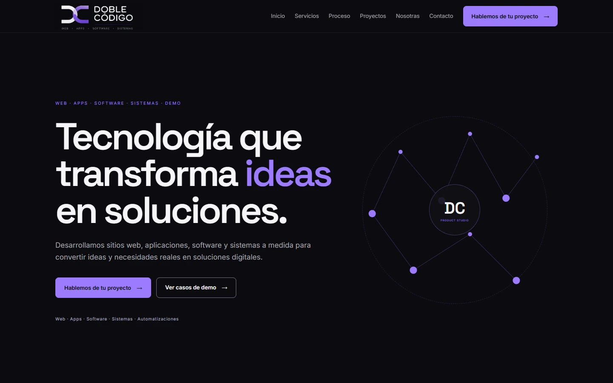

# Doble Código

Doble Código es una landing page responsive que diseñé y desarrollé para un estudio ficticio de software. El sitio presenta servicios digitales, un proceso de trabajo, tres casos de portfolio y una consulta interactiva de demostración. La identidad visual combina una paleta oscura con acentos violetas, un logotipo y una gráfica orbital.

**Proyecto de demostración.** Valentina Torres y Camila Fernández son nombres ficticios en el contexto del proyecto. El sitio no ofrece servicios comerciales. La consulta usa opciones de ejemplo para generar un borrador en el navegador, sin pedir datos personales, enviar mensajes ni guardar información.



## Funcionalidades

- Navegación por secciones de servicios, proceso, proyectos, equipo y contacto, con menú adaptado a pantallas pequeñas.
- Tres casos ficticios de portfolio: **Vitrina digital**, **Agenda simple** y **Panel de inventario**. Cada uno explica el desafío y el enfoque e incluye una vista ilustrada en HTML y CSS.
- Consulta de demostración con selección de tipo de proyecto y objetivo, y vista previa local del borrador.

## Capturas

- [Portada en celular](docs/capturas/portada-celular.webp)
- [Proyectos de demostración](docs/capturas/proyectos-demostracion.webp)
- [Consulta simulada](docs/capturas/consulta-simulada.webp)

## Tecnologías

| Tecnología | Uso |
| --- | --- |
| React y JavaScript | Componentes, menú móvil y estado de la consulta |
| CSS | Diseño responsive, gráfica orbital y vistas de los casos |
| Vite | Servidor de desarrollo, compilación y vista previa |
| Playwright | Pruebas automatizadas de navegador |

## Instalación y ejecución

Necesitás Git y Node.js 22.12 o posterior con npm. Copiá la URL HTTPS desde **Code** en GitHub y reemplazá `URL_DEL_REPOSITORIO` por esa dirección.

```sh
git clone URL_DEL_REPOSITORIO doble-codigo
cd doble-codigo
npm ci
npm run dev
```

Abrí la dirección local que imprime Vite. Para verificar la versión de producción en tu equipo, ejecutá:

```sh
npm run build
npm run preview
```

El resultado de la compilación queda en `dist/`.

## Accesibilidad, seguridad y rendimiento

- **Accesibilidad.** Enlace para saltar al contenido, foco visible, navegación por teclado y cierre del menú y de la consulta con Escape. El diálogo enfoca el primer campo al abrirse y devuelve el foco al control correspondiente al cerrarse. El sitio respeta la preferencia de movimiento reducido.
- **Seguridad y privacidad.** Actualicé Vite y su dependencia transitiva `source-map-js` para resolver dos avisos de severidad alta. La auditoría final de la Etapa 3 informó cero avisos. La consulta funciona en memoria y las pruebas verifican que no envíe solicitudes ni escriba datos persistentes.
- **Rendimiento.** Las vistas del portfolio se renderizan en HTML y CSS. En tres cargas locales de producción con perfil móvil, caché desactivada y red y CPU simuladas, la mediana de LCP fue de 1,44 s y el CLS fue de 0,002. Son mediciones de laboratorio sobre la versión local.

## Pruebas automatizadas

```sh
npx playwright install chromium
npm test
```

`npm test` genera la compilación de producción, inicia una vista previa local y ejecuta 10 pruebas. Cubren enlaces internos, navegación y foco por teclado, menú móvil, consulta simulada, contenido ficticio y distribución responsive en siete anchos. Para usar una instalación existente de Google Chrome, configurá la variable de entorno `DOBLE_CODIGO_BROWSER` con el valor `chrome`.

## Publicación

El proyecto todavía no tiene un dominio definitivo. El sitemap se incorporará cuando se defina la URL pública.
